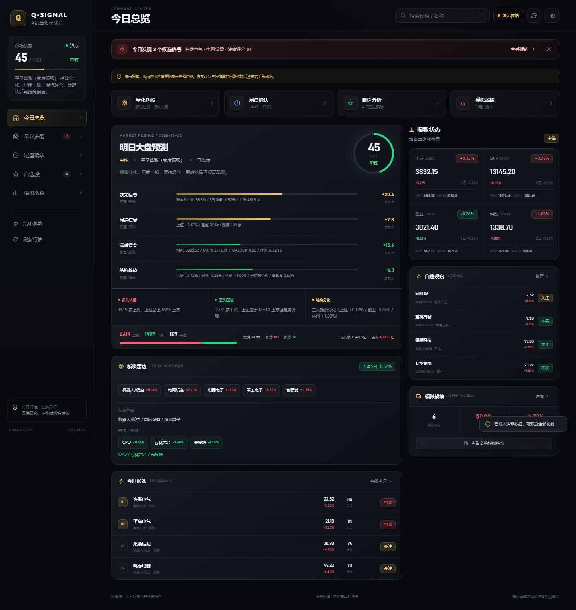
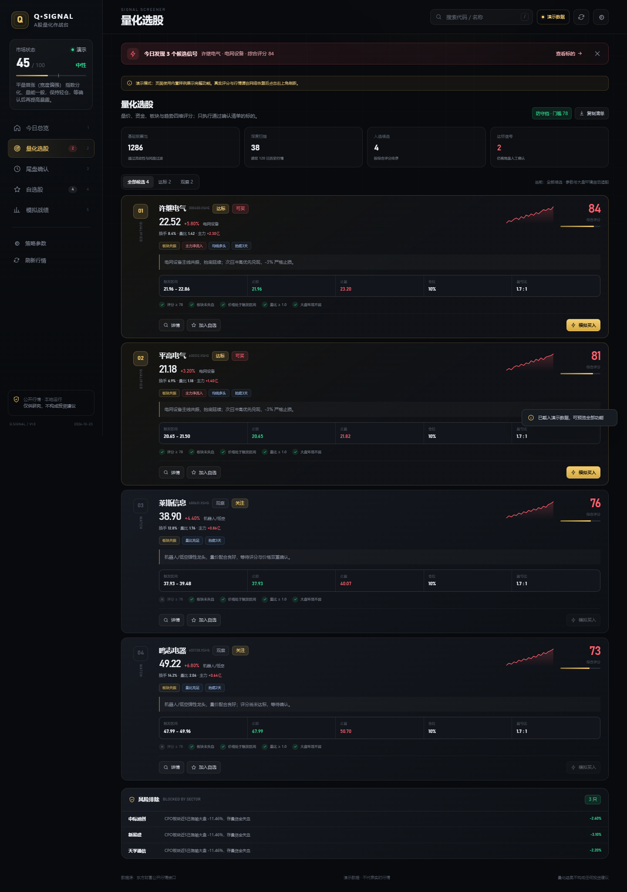
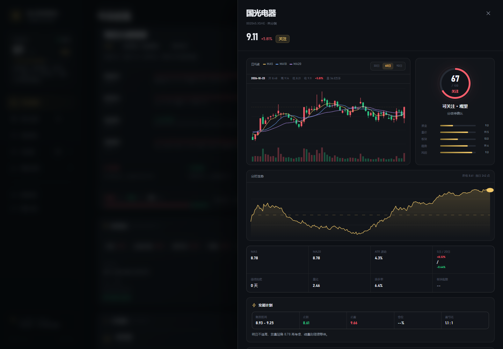

# 智能选股 · A股量化作战台

一个可以自己部署的 A 股看盘与选股工具：大盘评分、板块雷达、尾盘选股、自选股 K 线、模拟战绩，一个页面全搞定。

- 在线体验：https://fengmu.me/stock/
- 纯 Node.js，无数据库、无 npm 依赖，下载即跑
- 同时适配电脑和手机



## 功能

- **大盘评分**：综合指数涨跌、涨跌家数、成交额、北向等维度给出 0–100 的市场温度
- **板块雷达**：按强弱排序行业/概念板块，快速找到当天主线
- **尾盘选股**：多因子打分（趋势、量能、资金、位置），评分阈值、持仓数、止盈止损、刷新频率都可调
- **自选股 + 个股详情**：分时、日 K、指标（MA / MACD / RSI / KDJ / BOLL）
- **模拟战绩**：记录买入卖出，自动统计胜率、盈亏比
- **双数据源**：同花顺为主，东方财富自动兜底
- **响应式界面**：手机浏览器直接使用




## 快速开始

需要 Node.js 20 或更高版本。

```bash
git clone https://github.com/<your-name>/smart-stock-picker.git
cd smart-stock-picker
node server.js --open
```

打开 http://127.0.0.1:8787 即可。

Windows 用户也可以直接双击：

- `启动量化工具.cmd`：本机使用
- `手机访问.cmd`：手机和电脑连同一个 Wi-Fi，用手机打开窗口里显示的地址

## 配置

通过环境变量调整：

| 变量 | 默认值 | 说明 |
| --- | --- | --- |
| `HOST` | `127.0.0.1` | 监听地址，局域网访问用 `0.0.0.0` |
| `PORT` | `8787` | 监听端口 |
| `LAN` | - | 设为 `1` 等同于 `--lan` |
| `QSIGNAL_DATA_DIR` | `./data` | 自选股、模拟战绩、设置的存放目录 |

命令行参数：

```bash
node server.js            # 本机访问
node server.js --lan      # 局域网/手机访问
node server.js --open     # 启动后自动打开浏览器
```

## 部署到服务器

`deploy/` 里提供了 systemd 服务和 Nginx 反向代理示例，详见 [deploy/README.md](deploy/README.md)。

核心思路：Node 服务常驻在 `127.0.0.1:8787`，Nginx 把 `/stock/` 反代过去。

## 测试

```bash
npm test
```

覆盖指标计算、策略打分、数据源解析、状态存储。

## 目录结构

```
server.js          HTTP 服务与 API
lib/               行情抓取、指标、策略、存储
public/            前端页面（原生 HTML/CSS/JS）
tests/             node:test 单元测试
deploy/            systemd / Nginx 部署示例
docs/screenshots/  README 截图
```

## 说明与免责声明

- 行情数据来自公开网页接口，可能延迟或失败，不保证实时性与准确性。
- 本项目仅用于技术学习与个人研究，**不构成任何投资建议**，据此操作风险自负。
- 请遵守数据来源网站的使用条款，不要高频抓取。

## License

[MIT](LICENSE)
